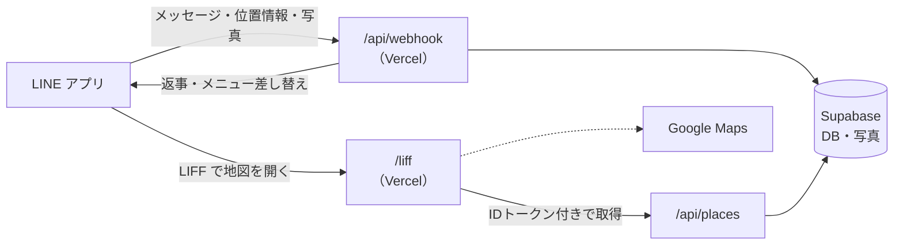
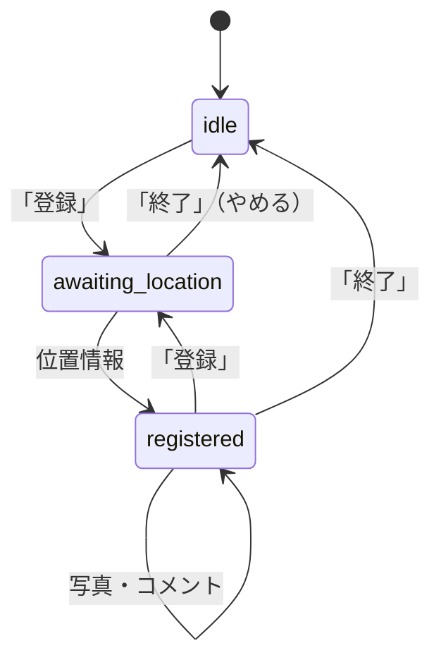

# 好きな場所Bot

LINE で送った場所が、LINE の中の地図に並ぶ Bot です。

| Step | 使う機能 | できること |
|---|---|---|
| 1 | LINE Bot（Messaging API） | 会話の状態を覚える・Quick Reply で位置情報を送る・写真とコメントを保存する |
| 2 | LIFF | LINE の中で地図を開く・IDトークンで本人を確かめる・shareTargetPicker で共有する |
| 3 | リッチメニュー | 状態に合わせてメニューを差し替える・richmenuswitch でタブ切り替え |

## 目次

- [しくみ](#しくみ)
- [自分の環境で動かす](#自分の環境で動かす約30分)
- [よく使うコマンド](#よく使うコマンド)
- [このアプリの作り方](#このアプリの作り方)

## しくみ



会話の状態は `line_users.state` に保存し、届いたものによって次の3つを行き来します（[src/lib/state-machine.ts](src/lib/state-machine.ts)）。



| 状態 | 意味 | 状態が変わらないときの返事 |
|---|---|---|
| `idle` | 何もしていない | テキストはおうむ返し、位置情報は「先に『登録』と送って」と案内 |
| `awaiting_location` | 位置情報を待っている | 「位置情報を送ってください」と促す |
| `registered` | 場所を登録した直後 | テキストはコメント・写真はその場所に追加。位置情報は「先に『登録』と送って」と案内 |

| ファイル | 役割 |
|---|---|
| `src/app/api/webhook/route.ts` | LINE からの知らせの受け口（署名の確認） |
| `src/lib/state-machine.ts` | 状態の切り替えを決める（`idle` → `awaiting_location` → `registered`） |
| `src/lib/webhook-handler.ts` | 決まったことを実行する（保存・返事・メニュー差し替え） |
| `src/lib/quick-reply.ts` | 返事に付けるボタン |
| `src/lib/rich-menu.ts` | 状態ごとのリッチメニュー |
| `src/app/liff/` | LINE の中で開く地図と詳細の画面 |
| `src/app/api/places/` | LIFF 向けの API（IDトークンで本人確認） |
| `supabase/migrations/` | テーブル・RLS・写真のバケット |
| `scripts/` | リッチメニュー作成・Supabase の確認・データ削除 |

## 自分の環境で動かす（約30分）

### 用意するもの

- LINE アカウント、GitHub アカウント、Google アカウント
- Node.js 20 以上、[Supabase CLI](https://supabase.com/docs/guides/cli)

どれも無料枠で動きますが、**Google Maps だけは Google Cloud に請求先アカウント（クレジットカード）の登録が必要**です。

### 発行するキー（8つ）

`.env.local` と Vercel の環境変数に、次の8つを入れます。🔒 は秘密の値なので、人に見せたり Git に入れたりしないでください（`.env.local` は `.gitignore` 済み）。

| キー | どこで取るか | 秘密 |
|---|---|---|
| `LINE_CHANNEL_SECRET` | Messaging API チャネル > チャネル基本設定 | 🔒 |
| `LINE_CHANNEL_ACCESS_TOKEN` | Messaging API チャネル > Messaging API設定 > チャネルアクセストークン（長期） | 🔒 |
| `LINE_CHANNEL_ID` | **LIFF を置いたチャネル**のチャネルID（Messaging API チャネルではない） | |
| `NEXT_PUBLIC_LIFF_ID` | LIFF を置いたチャネル > LIFF タブ | |
| `NEXT_PUBLIC_SUPABASE_URL` | Supabase > Project Settings > API Keys | |
| `NEXT_PUBLIC_SUPABASE_ANON_KEY` | 同上（Legacy API keys の anon） | |
| `SUPABASE_SERVICE_ROLE_KEY` | 同上（Legacy API keys の service_role） | 🔒 |
| `NEXT_PUBLIC_GOOGLE_MAPS_API_KEY` | Google Cloud > APIとサービス > 認証情報 | |

キーの発行をブラウザ操作の AI（Claude for Chrome など）に任せたい場合は、[docs/setup-prompts.md](docs/setup-prompts.md) のプロンプトを使えます。

### 1. コードを手元に持ってくる

このリポジトリを自分の GitHub アカウントに **Fork** してから clone します（Vercel は自分の GitHub にあるリポジトリを読み込むため）。

```bash
git clone https://github.com/<自分のアカウント>/techbookfest21-app-favorite-place.git
cd techbookfest21-app-favorite-place
npm ci
cp env.sample .env.local   # これから発行するキーを書いていく
```

### 2. Supabase（データの置き場）

ダッシュボードで新しいプロジェクトを作り（リージョンは東京）、テーブルを作ります。

```bash
supabase login
supabase link --project-ref <Project ID>
npm run db:push           # supabase/migrations の SQL を適用
```

Project URL・anon・service_role を `.env.local` に書き、設計どおりに守られているかを確かめます。

```bash
npm run check-supabase    # anon で読むと全テーブル0件、写真のバケットは非公開ならすべて ✅
```

### 3. LINE のチャネルと LIFF

LINE Developers コンソールで、Bot 用の Messaging API チャネルと、LIFF を置くチャネル（LINE ミニアプリ または LINE ログイン）を**同じプロバイダー**に作ります。プロバイダーが違うと、同じ人でもユーザーIDが別になり動きません。

- Messaging API チャネル: 「応答メッセージ」「あいさつメッセージ」はオフ、「Webhookの利用」はオン
- LIFF: サイズ Full、Scope は `openid` と `profile`。エンドポイント URL はデプロイ後に入れるので、いったん仮の URL で作る

### 4. Google Maps の API キー

Google Cloud コンソールで Maps JavaScript API を有効にして API キーを作り、次の2つの制限をかけます。

- **ウェブサイトの制限**: `http://localhost:3000/*`（デプロイ後に Vercel の URL を追加）
- **API の制限**: Maps JavaScript API のみ

### 5. Vercel にデプロイ

Fork したリポジトリを Vercel に読み込みます（Framework Preset が Next.js になっているか確認。`vercel.json` でも指定済み）。環境変数に `.env.local` の8つを登録してデプロイし、出来上がった URL を次の3か所に設定します。

| どこ | 入れる値 |
|---|---|
| LINE の Webhook URL | `https://<デプロイ先>/api/webhook`（「検証」が成功すること） |
| LIFF のエンドポイント URL | `https://<デプロイ先>/liff` |
| Google Maps キーのウェブサイトの制限 | `https://<デプロイ先>/*` |

### 6. リッチメニューを作って、友だち追加

```bash
npm run create-rich-menu  # 状態ごとの4枚とエイリアスを作り、最初のメニューをデフォルトに
```

画像は `assets/rich-menu/` の4枚（2500×843）を使います。Messaging API チャネルの QR コードから友だち追加して、何か話しかけてみてください。

### 動いたかを確かめる

- [ ] テキストを送ると、おうむ返しに「📍 場所を登録する」「🗺 地図で見る」のボタンが付く
- [ ] 「📍 場所を登録する」→「📍 位置情報を送る」で位置情報を送ると「登録しました」
- [ ] 続けて写真やコメントを送ると、Supabase の Table Editor に行が増える
- [ ] 「✅ 終了」で最初の状態に戻り、リッチメニューも切り替わる
- [ ] 「🗺 地図で見る」で地図にピンが立ち、詳細から共有できる

### 詰まりやすいところ

| 症状 | 原因 |
|---|---|
| 何を送っても返事が来ない | 「Webhookの利用」がオフ／Webhook URL が違う |
| 返事が二重に来る | 「応答メッセージ」がオンのまま |
| デプロイ後に全ページ 404 | Vercel の Framework Preset が Next.js になっていない |
| LIFF が「読み込み中」のまま | 画面に止まっている段階とエラーが出るので確認。LIFF ID とエンドポイント URL の組み合わせを見直す |
| 地図の API が 401 | `LINE_CHANNEL_ID` が LIFF を置いたチャネルの ID になっていない |
| 地図が灰色・エラー表示 | Google Maps キーのウェブサイトの制限にデプロイ先の URL が入っていない |

## よく使うコマンド

| コマンド | 内容 |
|---|---|
| `npm run dev` | ローカルで起動（Webhook を試すときは ngrok などで公開する） |
| `npm test` | 状態遷移・Quick Reply・リッチメニューの単体テスト |
| `npm run build` | 本番ビルド |
| `npm run check-supabase` | RLS とバケットが設計どおりか確かめる |
| `npm run create-rich-menu` | リッチメニューを作り直す（何度実行してもよい） |
| `npm run reset-data` | 登録した場所・写真・コメント・会話の状態を全部消す（元に戻せない） |

## このアプリの作り方

AI（Claude Code）に短いプロンプトを渡し、仕様（requirements → design → tasks）を人が確認しながら作りました。実際のプロンプトは [docs/how-it-was-built.md](docs/how-it-was-built.md) にあります。
